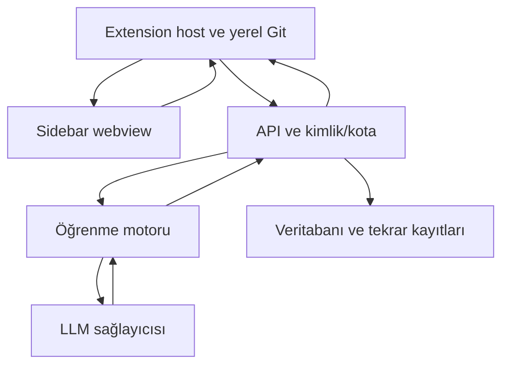

# Extension-first mimari

## Sınırlar
Ahmet: host komutları, bounded Git adapter, onay/önizleme, webview ve API istemcisi.
Derviş: backend kimlik, analiz/durum/cevap endpointleri, idempotency, kota ve motor adapter.
Murathan: motor içi kavram, soru, rubrik, değerlendirme ve tekrar önerisi.
Efe: sürümlü sözleşme, DB migration, CI ve entegrasyon fixture'ları.

Webview dosya sistemi veya LLM anahtarına doğrudan erişmez. Mesaj türleri allowlist ve payload doğrulamasıyla host'ta ele alınır. Workspace trust, dosya sınırları, CSP ve SecretStorage gibi güvenlik detayları Ahmet'in uygulama PR'ında resmî API belgeleriyle doğrulanmalıdır.

## Veri
Yerel diff base_commit_sha + snapshot_id (diff içeriğinin SHA-256 özeti) ile sabitlenir. Snapshot, HEAD commit'inden farklı değişiklik içerebilir; kanıt yerel snapshot'a aittir. Diff değişirse yeni analizdir. Kaynak konumu değişmişse uyarı verilir.
Backend kullanıcı kimliğini oturumdan belirler; body'de user_id alınmaz. idempotency anahtarı kullanıcı + repository_id + snapshot_id + pipeline_version + sözleşme sürümüdür.

## Mock ile paralellik
Extension fixture'ı render eder; API fake motor çağırır; motor fake provider kullanır; DB migration ve CI bunlardan bağımsız ilerler. Ortak biçim contracts/v1/ altında.
