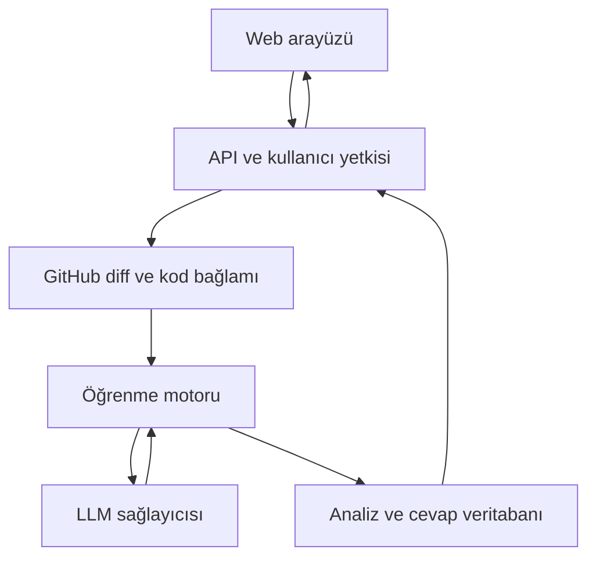

# Mimari
## Önerilen yapı
Tek repository içinde web uygulaması, API ve öğrenme modülü. learning ilk MVP'de API tarafından çağrılan Python paketi olabilir; ayrı servis zorunlu değildir.

## Sınırlar
- web: repository seçimi, sorular, cevaplar ve geri bildirim.
- api: oturum, erişim kontrolü, GitHub istemcisi, işlem yaşam döngüsü.
- learning: bağlam seçimi, kavram çıkarımı, soru ve rubrik, cevap değerlendirme.
- contracts: ortak şemalar ve örnek payloadlar.
- DB: kullanıcı, analiz, kavram, soru, cevap, değerlendirme, tekrar ve kullanım kaydı.

## İşlem yaşam döngüsü
queued → fetching → generating → ready; başarısız adım failed olur. Yeniden deneme aynı kullanıcı + repository + commit SHA + pipeline sürümü için mükerrer ücretli işlem üretmemelidir.

## Kanıt ve belirsizlik
Git diff kodun AI tarafından yazıldığını güvenilir biçimde göstermez. AI/manüel satır oranı telemetry olmadan raporlanmaz. Mimari gerekçeler kod veya ADR kanıtıyla desteklenir; çıkarım ise açıkça belirtilir.

## Bütçe
Tüm repo her soruda modele gönderilmez. Dosya filtreleri, diff sınırı, bağlam seçimi ve token üst sınırı uygulanır. Sağlayıcı fiyatları ve modeller uygulama öncesi güncel resmî kaynaklardan doğrulanır; bu repo sabit maliyet taahhüdü içermez.
